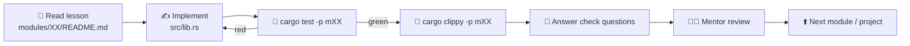
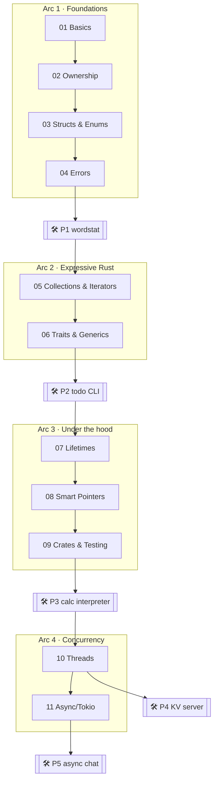

# 🦀 Rust Mentor — learn Rust by building

A hands-on Rust course for developers who already know **Go, Java or Python**.
Each module is a lesson (`README.md`) + exercises (`src/lib.rs`) + tests
(`src/tests.rs`) that act as the spec. Every few modules you build a real project.

## 🚀 Setup (≈10 minutes)

1. **Install Rust** via rustup → <https://rustup.rs>
   * macOS / Linux: `curl --proto '=https' --tlsv1.2 -sSf https://sh.rustup.rs | sh`
   * Windows: run `rustup-init.exe` (it will offer to install the MSVC build tools — say yes)
2. **Open this folder in VS Code** and accept the *"install recommended extensions"* prompt:

   | Extension | Why |
   |---|---|
   | rust-analyzer | completion, inline errors, type hints, ▶ Run Test buttons |
   | CodeLLDB | debugger (▶ Debug buttons above tests) |
   | Even Better TOML | `Cargo.toml` support |
   | Error Lens | shows compiler errors inline, right on the line |
   | Markdown Mermaid | renders the diagrams in lessons (`Ctrl/Cmd+Shift+V`) |

3. **Verify** in the VS Code terminal:
   ```bash
   cargo --version            # if rustup complains, run: rustup toolchain install
   cargo run -p playground    # → Hello, Rust!
   cargo run -q -p progress   # → your dashboard (everything at 0 for now)
   ```

## 🔁 The learning loop



Rules of the game:

* **Don't edit the tests** (`src/tests.rs`). They're the specification.
* Every `todo!()` is a function for you to write. It compiles, but panics when called.
* Each `lib.rs` starts with `#![allow(unused_variables, ...)]` to keep the noise down. **Delete that line when you finish the module** and fix whatever warnings appear.
* Stuck for more than ~20 minutes? Ask your mentor for a hint (see below).

## 🗺️ Roadmap



| Step | Topic | Status | Run |
|---|---|---|---|
| 01 | [Basics](modules/01-basics/README.md) | ✅ ready | `cargo test -p m01-basics` |
| 02 | [Ownership & Borrowing](modules/02-ownership/README.md) | ✅ ready | `cargo test -p m02-ownership` |
| 03 | [Structs, Enums & Pattern Matching](modules/03-structs-enums/README.md) | ✅ ready | `cargo test -p m03-structs-enums` |
| 04 | [Error Handling](modules/04-error-handling/README.md) | ✅ ready | `cargo test -p m04-error-handling` |
| P1 | [wordstat CLI](projects/p1-wordstat/README.md) (milestones 1–3) | ✅ ready | `cargo test -p wordstat` |
| 05 | [Collections, Iterators & Closures](modules/05-collections-iterators/README.md) | ✅ ready | `cargo test -p m05-collections-iterators` |
| 06 | Traits & Generics → P2 todo CLI | 🔒 unlock with mentor | |
| 07–09 | Lifetimes · Smart pointers · Crates & testing → P3 calc | 🔒 | |
| 10–11 | Threads · Async → P4 KV server, P5 chat | 🔒 | |
| 12 | Macros, unsafe, FFI (optional) | 🔒 | |

Locked modules are unlocked one at a time, tuned to how you did on the previous ones.

## ⌨️ Command cheat sheet

| Command | What it does | Go equivalent |
|---|---|---|
| `cargo test -p m01-basics` | run one module's tests | `go test ./basics` |
| `cargo test -p m01-basics fizz` | only tests whose name contains "fizz" | `go test -run Fizz` |
| `cargo clippy -p m01-basics` | linter with great suggestions | `go vet` + staticcheck |
| `cargo fmt` | format everything | `gofmt` |
| `cargo run -p playground` | run your scratchpad | `go run .` |
| `cargo run -q -p progress` | progress dashboard | — |
| `cargo doc --open` | browse docs for your code + deps | `go doc` |
| `rustup doc --std` | offline standard library docs | — |

**VS Code:** `Ctrl/Cmd+Shift+P` → *Tasks: Run Test Task* runs the tests of whichever file is open. Or click **▶ Run Test** above any `#[test]`.

## 👨‍🏫 Working with your mentor (Claude)

* **Review:** paste your finished `lib.rs` (or the functions you're unsure about) and say *"review module 02"*. You'll get feedback on correctness, idioms, and ownership choices — plus a follow-up question or two.
* **Hints come in levels**, so you never get the answer before you want it:
  1. *nudge* — which concept applies
  2. *pointer* — which std API / doc page
  3. *sketch* — pseudo-code
  4. *solution* — only when you ask for it
* **Compiler error you don't get?** Paste the *full* error. Learning to read them is half of learning Rust.
* **Unlock:** *"I finished module 05, unlock module 06."*
* Using **Claude Code** inside VS Code? `CLAUDE.md` already configures it as your mentor.

Track your journey in [PROGRESS.md](PROGRESS.md). See [docs/cheatsheet.md](docs/cheatsheet.md) for a Go/Java/Python → Rust translation table.

## 📚 Companion resources

| Resource | Use it for |
|---|---|
| [The Rust Book](https://doc.rust-lang.org/book/) | the canonical deep explanation of each topic |
| [Rust by Example](https://doc.rust-lang.org/rust-by-example/) | quick runnable snippets |
| [std docs](https://doc.rust-lang.org/std/) | press `S` to search — learn to love it |
| [Rust Playground](https://play.rust-lang.org/) | share snippets with your mentor |
| [Clippy lint list](https://rust-lang.github.io/rust-clippy/master/) | understand *why* clippy complains |
