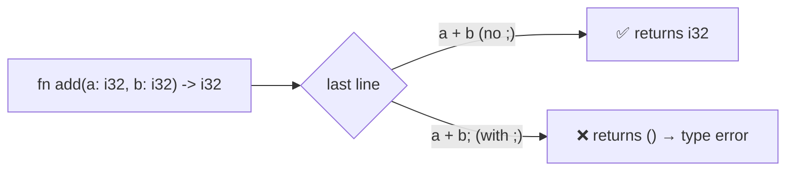

# Module 01 — Basics: Variables, Types, Functions, Control Flow

> **Goal:** get comfortable with Rust syntax and its two big early surprises:
> **immutability by default** and **almost everything is an expression**.
>
> ⏱️ ~2–3 hours · 🧪 `cargo test -p m01-basics`

## 0. Why does Rust look different? (read this first)

Rust's syntax isn't different for its own sake. Almost every choice follows
from four goals. Throughout the tutorial, a **💡 Why?** note under each piece
of syntax ties it back to one of them.

| Goal | What it means | Go / Java / Python instead… | Syntax it explains |
|---|---|---|---|
| 🛡️ **Catch bugs at compile time** | if it compiles, whole classes of bugs are gone | find them at runtime (or in production) | exhaustive `match`, no null, no implicit conversions |
| 👀 **Explicit over implicit** | costs and side effects are visible in the code | hide copies, conversions, mutation, exceptions | `mut`, `&`, `.clone()`, `as`, `?` |
| ⚡ **Zero-cost abstractions** | high-level code compiles to what you'd hand-write | pay for a GC, boxing, runtime checks | sized ints, iterators, generics |
| 🧮 **Expression-oriented** (ML heritage) | almost everything produces a value | split code into statements vs expressions | `if` / `match` / blocks return values |

**The trade-off:** Rust is stricter and a bit wordier up front, and in return
you get fewer surprises later. When some syntax feels fussy, ask *"which bug is
this preventing?"* The answer is usually one of the rows above.

## 1. Variables: immutable by default

```rust
let x = 5;          // immutable — like Java `final`, unlike Go/Python
let mut y = 5;      // opt-in mutability
y += 1;
const MAX: u32 = 100_000;   // compile-time constant, type annotation required
```

> 💡 **Why `let`?** Python's `x = 5` can't tell *creating* a variable from
> *changing* one, so a typo like `totl = 0` silently makes a new variable. A
> `let` keyword (like Go's `:=` vs `=`) turns that typo into a compile error.
> `let` also takes a *pattern*, e.g. `let (a, b) = (1, 2);`.

> 💡 **Why immutable by default?** Most variables are never reassigned. Making
> `mut` opt-in means the few that *do* change stand out to anyone reading the
> code. Java has `final`, but it's opt-in, so hardly anyone writes it. Rust
> makes the safe choice the shortest one to type. This also powers the
> borrowing rules in Module 02, which need to know exactly who can mutate what.

> 💡 **Why `name: Type` (type after the name)?** Because the type is usually
> optional. `let x = 5` and `let x: i64 = 5` read the same way, and the
> annotation just drops off when it's inferred. Go, Kotlin, Swift and
> TypeScript made the same choice; Java's `int x` form only works well when the
> type is always written.

> 💡 **Why must `const` have a type?** A constant is part of your API and gets
> inlined everywhere it's used. Rust only infers types *inside* function
> bodies, so items like `const`, `static` and `fn` signatures always spell out
> their types. (`100_000`: the `_` is just a readable digit separator, as in
> Java, Go and Python.)

**Shadowing** — re-declaring a name with `let` creates a *new* variable (can even change type):

```rust
let input = "42";              // &str
let input: i32 = input.parse().unwrap(); // now i32 — old one is shadowed
```

> 💡 **Why allow shadowing?** It lets a value go through stages (raw text →
> parsed number) without names like `input_str` / `input_num`, and every stage
> stays immutable. The old value becomes unreachable, so you can't use the
> stale one by mistake. Python "reuses" a name by mutating the variable and
> changing its type silently. Rust makes a fresh binding, and every use is
> still type-checked.

| Concept | Go | Java | Python | Rust |
|---|---|---|---|---|
| Declare | `x := 5` | `var x = 5;` | `x = 5` | `let x = 5;` |
| Mutable? | yes | yes | yes | **no** — need `let mut` |
| Constant | `const` | `static final` | convention | `const` |
| Re-declare same name | ❌ (same scope) | ❌ | just reassign | ✅ shadowing |

## 2. Scalar types — sizes are explicit

| Rust | Meaning | Go equivalent | Java equivalent |
|---|---|---|---|
| `i8 i16 i32 i64 i128` | signed ints | `int8`…`int64` | `byte short int long` |
| `u8 u16 u32 u64 u128` | unsigned ints | `uint8`…`uint64` | (none!) |
| `isize / usize` | pointer-sized (indexes, lengths) | `int / uint` | — |
| `f32 f64` | floats | `float32 float64` | `float double` |
| `bool` | `true/false` | `bool` | `boolean` |
| `char` | a **Unicode scalar**, 4 bytes | `rune` | `char` is 2 bytes (UTF-16) |

> 💡 **Why such terse, sized names?** The name *is* the spec: letter = kind
> (`i` signed, `u` unsigned, `f` float), number = bits. Rust runs on everything
> from microcontrollers to servers, so a vague `int` whose size depends on the
> platform (as in C) would behave differently on each one. `usize` is the
> exception on purpose: indexes and lengths must match the machine's address
> size.

> 💡 **Why a 4-byte `char`?** Java picked 2-byte `char` when Unicode fit in
> 65,536 characters. It no longer does, so an emoji in Java is *two* `char`s
> and a Java `char` can be half a character. A Rust `char` always holds one
> complete Unicode scalar value, like Go's `rune`.

⚠️ **No implicit conversions.** `let a: i64 = some_i32;` does not compile. Use `some_i32 as i64` or `i64::from(some_i32)`.

> 💡 **Why so strict?** Silent conversions are a classic bug source. In Java,
> `long x = a * b;` multiplies as `int`, overflows, and *then* widens. In Rust
> every conversion is visible in the code. `From` only exists for lossless
> conversions: `i64::from(i32)` exists, `i32::from(i64)` doesn't (use
> `i32::try_from`, which can fail). `as` is the blunt tool that may truncate,
> and it's easy to spot in review.

⚠️ **Overflow panics in debug builds** (wraps in release). Want explicit behavior? Use `checked_add`, `wrapping_add`, `saturating_add`.

> 💡 **Why named methods for overflow?** Go and Java always wrap silently, and
> Python ints never overflow (they grow, at a speed cost). Rust makes you
> *say* what you mean: `checked_` (give me `None`), `wrapping_` (wrap on
> purpose, e.g. hashing), `saturating_` (clamp at the max). As for *why debug
> builds panic*, that's question 3 at the bottom. Think about it first!

## 3. Expressions vs statements — the key idea

A block `{ ... }` evaluates to its **last expression** (no semicolon). Adding `;` turns it into a statement that yields `()` ("unit", like `void`).



> 💡 **Why must function signatures spell out types, when `let` infers them?**
> A signature is a contract. Inference stops at function boundaries, so editing
> one function's body can never silently change the types its callers see, and
> type errors are reported where they happen, not three files away. Go and
> Java require this too; Python's type hints are optional. The `->` arrow comes
> from math and ML-family languages (`f: A → B`).

> 💡 **Why does `;` change the meaning?** In Rust, `;` means "evaluate this
> and throw the value away". So a function's last expression *is* its return
> value, with no `return` needed, which keeps short functions tidy (like
> `lambda` in Python). `return` still exists for *early* exits.

So `if`, `match`, `loop`, and blocks are all expressions:

```rust
let label = if n % 2 == 0 { "even" } else { "odd" };      // like a ternary
let steps = loop { if done() { break 10; } };               // loop returns a value
let size = match n { 0 => "zero", 1..=9 => "small", _ => "big" };
```

> 💡 **Why make `if`/`match` expressions?** Rust inherits this from the ML
> family (its first compiler was written in OCaml). You get one construct
> instead of two (no separate ternary `?:`; Go doesn't even have one), and
> variables can be set **once** with their final value: no `let mut label;`
> followed by assignments in each branch. The compiler also checks that every
> branch produces the same type.

## 4. Control flow cheat sheet

| Construct | Rust | Notes |
|---|---|---|
| Counted loop | `for i in 0..10` | `0..10` excludes 10, `0..=10` includes it |
| Iterate a collection | `for x in &v` | `&v` borrows (Module 02 explains why) |
| While | `while cond { }` | no parentheses needed |
| Infinite | `loop { }` | `break value;` returns a value |
| Switch | `match x { ... }` | **must be exhaustive** — compiler checks every case |
| Labeled break | `'outer: loop { break 'outer; }` | like Go/Java labels |

> 💡 **Why? (one line per row)**
>
> * **Half-open `0..10`:** it matches indexing (`0..v.len()`), its length is
>   `end - start`, and `0..5` + `5..10` join with no overlap. Python's
>   `range(0, 10)` works the same way. Use `..=` when you need the inclusive form.
> * **Only `for x in …` (no C-style `for(;;)`):** no off-by-one index
>   arithmetic, and no bounds check needed per step. Same idea as Python's `for`.
> * **No `( )` around conditions, but `{ }` always required:** mandatory braces
>   prevent bugs like Apple's 2014 "goto fail", where an un-braced `if` ran the
>   wrong line. Once braces are required, the parentheses are redundant. Go
>   chose the same.
> * **`loop` instead of `while true`:** the compiler *knows* a `loop` only exits
>   via `break`. That lets it return a value (`break 10`) and prove that
>   variables assigned inside are initialized. A `while` might run zero times,
>   so it can do neither.
> * **Exhaustive `match`, no fallthrough:** forgetting a case, or a missing
>   `break` in a Java/C `switch`, is a compile error instead of a runtime bug.
>   More in Module 03.
> * **`'outer` label:** the leading `'` is the same sigil Rust uses for
>   lifetimes (Module 07). Both *name a region of code*.

## 5. A first look at strings

Two string types — Module 02 explains *why*:

* `&str` — a borrowed view into UTF-8 text (string literals are `&'static str`)
* `String` — an owned, growable, heap-allocated buffer

For now: take `&str` as input, return `String` when you build new text.

> 💡 **Two string types sounds odd, but you've seen it before:** Java has
> `String` + `StringBuilder`, Go has `string` + `[]byte`. Rust's split is about
> *who owns the memory* rather than mutability. Module 02 shows why that
> matters.

## 6. Syntax decoder — symbols you'll meet early

| Symbol | Example | Means | 💡 Why this syntax? |
|---|---|---|---|
| `!` | `println!("{x}")` | macro call, expanded at compile time | Rust functions have no varargs or overloading; macros do, and they check the format string *at compile time* (wrong arg count = compile error). The `!` warns you it's not a normal call. |
| `::` | `String::from("hi")` | path: module, type, or enum variant | keeps "things on a *type/module*" (`::`) apart from "things on a *value*" (`.`). Java uses `.` for both. |
| `&` / `&mut` | `len(&s)` | borrow (Module 02) | you see at the **call site** whether a function borrows or modifies your data, which Java/Python calls never show |
| `?` | `s.parse()?` | return early on error (Module 04) | Go's 3-line `if err != nil { return … }` in one visible character |
| `\|x\|` | `\|x\| x * 2` | closure (Module 05) | short and unambiguous inside expressions (borrowed from Ruby/Smalltalk blocks) |
| `'a` | `'outer: loop`, `&'a str` | loop label or lifetime (Module 07) | both name a *region of code*, so they share a sigil |
| `_` | `_ => …`, `let _ = f();` | "I don't care" | an explicit discard, the same as Go's `_` |
| `#[…]` | `#[derive(Debug)]` | attribute | like Java annotations / Python decorators, but processed at **compile** time |

## 🧪 Exercises (`src/lib.rs`)

| # | Function | Concept practiced |
|---|---|---|
| 1 | `celsius_to_fahrenheit` | expressions, implicit return |
| 2 | `fizzbuzz` | `if` as expression, `String` |
| 3 | `sum_of_squares` | ranges, `for`, first iterator |
| 4 | `fibonacci` | `let mut`, tuple assignment |
| 5 | `is_prime` | `while`, early `return` |
| 6 | `collatz_steps` | `loop` + `break value` |
| 7 | `grade` | exhaustive `match` with ranges |
| 8 | `min_max` | arrays, returning tuples |
| 9 | `count_vowels` | `chars()`, `matches!` |
| 10 | `safe_add` | overflow, `Option` preview |
| 11 | `parse_and_double` | shadowing |

## ⚠️ Common pitfalls coming from Go / Java / Python

* Writing `return x;` everywhere — idiomatic Rust uses the tail expression.
* Adding a `;` to the last line and getting `expected i32, found ()`.
* Mixing `i32` and `u64` in arithmetic — convert explicitly.
* `s[0]` on a string doesn't compile (UTF-8!). Use `s.chars()`.
  *Why:* UTF-8 characters are 1–4 bytes, so `s[0]` would either be slow
  (scan from the start) or return half a character. Rather than guess, Rust
  makes you pick `s.bytes()` or `s.chars()`.

## 🤔 Check your understanding (answer these to your mentor)

1. Why does `let x = 5; x = 6;` fail, but `let x = 5; let x = 6;` works? What's the difference?
2. What is the type of `{ 1 + 1; }`? Why?
3. Why might Rust choose to *panic* on overflow in debug mode instead of wrapping like Go?

➡️ Next: [Module 02 — Ownership & Borrowing](../02-ownership/README.md)
