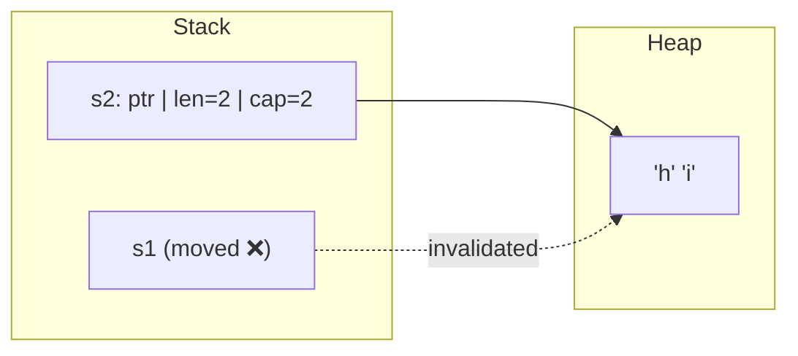
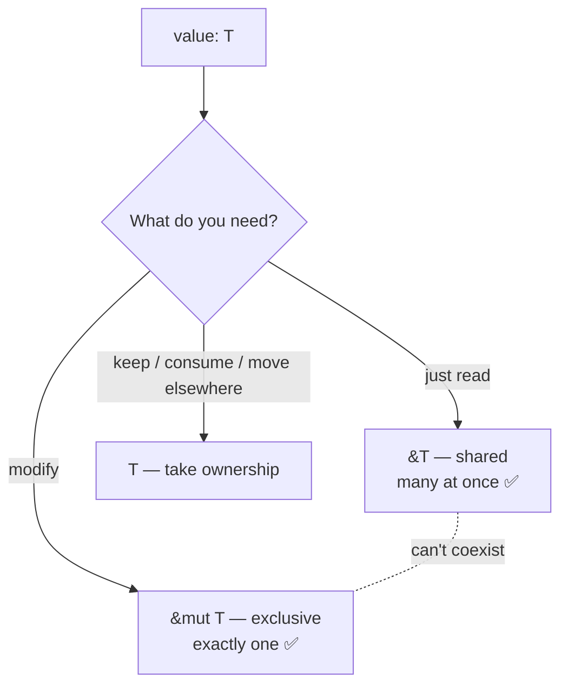
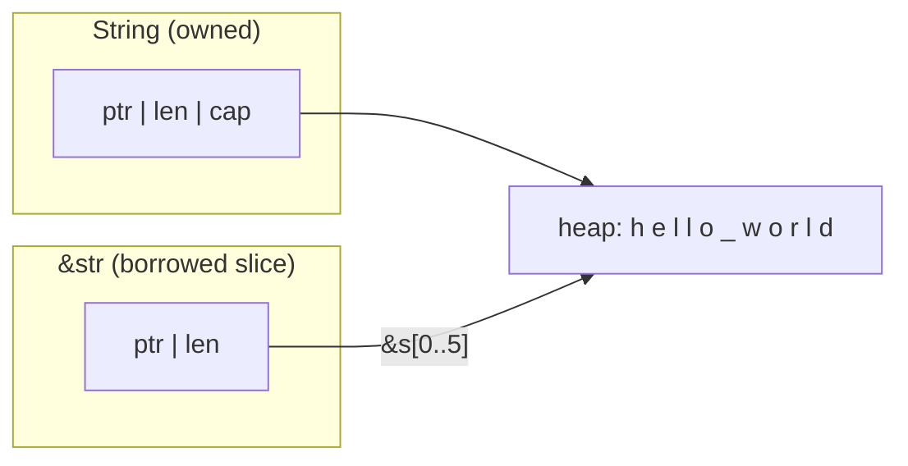

# Module 02 — Ownership & Borrowing 🦀 (the heart of Rust)

> **Goal:** understand *why* Rust needs no garbage collector and never has
> dangling pointers or data races — and learn to work *with* the borrow
> checker instead of fighting it.
>
> ⏱️ ~4–6 hours (take your time — everything later builds on this)
> 🧪 `cargo test -p m02-ownership`

## 1. Three languages, three memory strategies

| | Go | Java | Python | **Rust** |
|---|---|---|---|---|
| Who frees memory? | tracing GC | tracing GC | ref-counting + GC | **the compiler inserts frees** at scope end |
| When? | at some point | at some point | when refcount hits 0 | **deterministically**, when the owner goes out of scope |
| Runtime cost | GC pauses | GC pauses | refcount ops | **zero** |
| Aliasing + mutation | allowed (races possible) | allowed | allowed | **checked at compile time** |

## 2. The three ownership rules

1. Each value has exactly **one owner** (a variable).
2. There can only be one owner **at a time**.
3. When the owner goes out of scope, the value is **dropped** (freed).

### Move semantics

```rust
let s1 = String::from("hi");
let s2 = s1;            // ownership MOVES to s2 — no deep copy
println!("{s1}");       // ❌ error[E0382]: borrow of moved value: `s1`
```



In Java/Python, `s2 = s1` copies a *reference* — two names, one object, GC
figures it out later. Rust instead transfers responsibility for freeing,
so there's never a double free.

> 💡 **Why move instead of copy?** In C++, `std::string s2 = s1;` silently
> **deep-copies** (a hidden allocation). In Java/Python it shares a reference,
> which needs a GC or refcounting at runtime to know when to free. Rust picks a
> third option: `=` is *always* a cheap bitwise move, and the old name is
> invalidated. That gives you one rule you can rely on everywhere: **assignment
> never allocates and never leaves two owners.**

### `Copy` types don't move

Simple stack-only types (`i32`, `f64`, `bool`, `char`, tuples/arrays of them)
implement `Copy` — assignment duplicates the bits. That's why
`let a = 5; let b = a;` leaves `a` usable.

> 💡 **Why the special case?** For a small value with no heap memory, copying
> the bits costs the same as moving them, and there's nothing to double-free,
> so invalidating `a` would just be annoying. `Copy` is an opt-in *trait*: the
> type's author decides, and a type that owns heap memory (or has a
> destructor) can never be `Copy`.

### `Clone` = explicit deep copy

```rust
let s2 = s1.clone();   // you SEE the allocation. No hidden copies in Rust.
```

> 💡 **Why make deep copies explicit?** Performance problems hide in implicit
> copies (C++ copy constructors, Python's accidental `list(x)` in a loop).
> In Rust every expensive copy is a visible `.clone()` you can grep for, so
> code review catches them. If you see lots of `.clone()`, it's usually a hint
> to borrow instead.

## 3. Borrowing: references without taking ownership

```rust
fn len(s: &String) -> usize { s.len() }   // borrows, doesn't own
let s = String::from("hello");
let n = len(&s);        // lend it
println!("{s} {n}");    // ✅ still ours
```

> 💡 **Why must the caller write `&s`, not just `s`?** So you can tell at the
> **call site** what a function does with your data: `f(s)` takes it,
> `f(&s)` only reads it, `f(&mut s)` may change it. In Java or Python,
> `process(list)` gives no hint whether `list` gets modified; you have to read
> the function. Go's `f(&x)` gives a similar signal, but Rust also enforces it.

### The borrowing rule (memorize this!)

> At any given time you can have **either** any number of shared
> references `&T` **or** exactly one mutable reference `&mut T` — never both.
> And references must never outlive the value they point to.



It's a **readers–writer lock checked at compile time**. This one rule
eliminates iterator invalidation, data races, and use-after-free.

> 💡 **Why so strict?** The dangerous combination is **aliasing + mutation**:
> two names for the same data while one of them changes it. Rust allows either
> one, never both at once. Go's race detector finds such bugs only if a test
> happens to trigger them, and Java finds them in production. Rust rules them
> out before the program runs. (Question 3 below walks through a concrete case.)

> 💡 **Why `&mut` instead of plain `&`?** Mutability is part of the *type*, so
> the signature `fn f(v: &mut Vec<i32>)` documents that `f` will modify `v`.
> Java can't say "this method won't touch my list". C++ has `const&`, but
> read-only is opt-in there. Rust uses the same default as `let`: read-only
> unless you say `mut`.

## 4. Choosing parameter types — the practical guide

| You want to… | Parameter type | Caller writes |
|---|---|---|
| Read text | `&str` (not `&String`) | `f(&my_string)` or `f("lit")` |
| Read a list | `&[T]` (not `&Vec<T>`) | `f(&my_vec)` |
| Modify caller's data | `&mut T` / `&mut [T]` | `f(&mut x)` |
| Store it / consume it | `T` (owned) | `f(x)` — `x` is moved |

`&String` auto-converts to `&str` and `&Vec<T>` to `&[T]` ("deref coercion"),
so the slice versions accept more inputs. Clippy will nag you otherwise.

> 💡 **Why prefer `&str` / `&[T]`?** It's the Rust version of "program to the
> interface": Java says take `List`, not `ArrayList`; Go says take `io.Reader`,
> not `*os.File`. Asking for the most general *borrowed view* lets callers pass
> a `String`, a literal, a sub-slice or an array, with no conversion or copy.

## 5. `String` vs `&str`, finally explained



* `String` ≈ Go's `[]byte` you own / Java `StringBuilder`
* `&str` ≈ Go's `string` header pointing into someone's memory
* Both are **always valid UTF-8**, which is why `s[0]` isn't allowed — byte 0
  might be half a character.

> 💡 **Why not one string type like Java/Python?** Rust separates *owning* text
> from *looking at* text. A `&str` can point into the middle of a `String`, at
> a literal baked into the binary, or into a file buffer, all **without
> copying**. Python's `s[2:5]` allocates a new string. **Why UTF-8** (and not
> Java's UTF-16)? It's compact for ASCII, it's what files and the web already
> use, and text needs no conversion at I/O boundaries.

## 🏋️ Borrow-Checker Gym

Paste each snippet into `playground/src/main.rs`, run `cargo run -p playground`,
**read the full error** (Rust errors are excellent), then fix it. Try to
predict the error *before* running.

```rust
// Gym 1 — use after move
let v = vec![1, 2, 3];
let w = v;
println!("{:?}", v);
```

```rust
// Gym 2 — mutable + immutable borrow overlap
let mut v = vec![1, 2, 3];
let first = &v[0];
v.push(4);
println!("{first}");
```

```rust
// Gym 3 — returning a reference to a local (dangling)
fn make() -> &String {
    let s = String::from("temp");
    &s
}
```

```rust
// Gym 4 — two mutable borrows
let mut s = String::from("x");
let a = &mut s;
let b = &mut s;
a.push('1');
b.push('2');
```

```rust
// Gym 5 — moving out of a borrowed Vec
let names = vec![String::from("Ann"), String::from("Bob")];
let r = &names;
let first: String = r[0];
```

<details><summary>💡 Hints (open only after trying)</summary>

1. `clone()`, or borrow with `&v`.
2. Do the `push` after the last use of `first` (the borrow ends at last use — "non-lexical lifetimes"), or copy the value out: `let first = v[0];`.
3. Return `String` (owned) instead of `&String`.
4. Use `a` fully before creating `b`.
5. `r[0].clone()`, or `let first: &String = &r[0];`.
</details>

## 🧪 Exercises (`src/lib.rs`)

| # | Function | Ownership lesson |
|---|---|---|
| 1 | `first_word` | return a borrowed slice into input |
| 2 | `make_greeting` | borrow in, owned out |
| 3 | `append_exclamation` | `&mut` mutation |
| 4 | `take_and_return` | move in, move out |
| 5 | `sum_slice` | `&[T]` accepts Vec, array, sub-slice |
| 6 | `largest` | `Option<&T>`, lifetime elision preview |
| 7 | `double_in_place` | `iter_mut()` and `*` deref |
| 8 | `split_name` | consuming a String |
| 9 | `concat_all` | `&String` → `&str` deref coercion |
| 10 | `long_words` | explicit `clone()` |
| 11 | `reverse_owned` | moving elements out of an owned Vec |

## 🤔 Check your understanding

1. In Exercise 8, why can the `None` branch return `full` itself without cloning?
2. Why does `largest` return `Option<&i32>` instead of `Option<i32>`? Which is better for `i32`? What about for a big struct?
3. Explain Gym 2 in terms of the readers–writer rule. What could go wrong at runtime in C++ or Go if this compiled? *(Hint: what does `push` do when capacity runs out?)*

➡️ Next: [Module 03 — Structs, Enums & Pattern Matching](../03-structs-enums/README.md)
