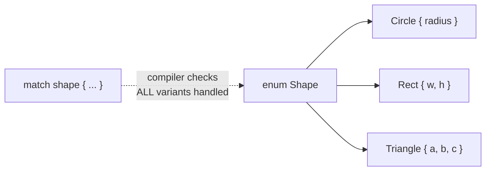

# Module 03 — Structs, Enums & Pattern Matching

> **Goal:** model your domain with types. Rust's enums are far more powerful
> than Java/Go enums — they're *sum types*, and combined with `match` they
> make illegal states unrepresentable.
>
> ⏱️ ~3–4 hours · 🧪 `cargo test -p m03-structs-enums`

## 1. Structs + `impl` blocks

Data and behavior are declared separately. There are **no classes and no inheritance**.

```rust
pub struct User { pub name: String, active: bool }   // `active` is private to the module

impl User {
    pub fn new(name: &str) -> Self { Self { name: name.to_string(), active: true } }
    pub fn is_active(&self) -> bool { self.active }      // borrows
    pub fn deactivate(&mut self) { self.active = false } // mutably borrows
    pub fn into_name(self) -> String { self.name }       // consumes the User
}
```

> 💡 **Why separate `struct` and `impl`, with no inheritance?** The data layout
> sits in one place, and behavior can be added in several `impl` blocks, even
> in other files (trait impls, Module 06). Go made the same split. Deep
> inheritance trees cause the "fragile base class" problem, where changing a
> parent breaks distant children. Rust uses composition plus traits instead.

> 💡 **Why private by default (`pub` opt-in)?** Same rule as `let` vs
> `let mut`: the safe choice is the short one. Privacy is per **module**, not
> per type. Go uses capitalization for this, Java defaults to package-private,
> and Python only has the `_name` convention, which nothing enforces.

> 💡 **Why no constructors, just `fn new() -> Self`?** A constructor is just
> an ordinary function that returns `Self`, like Go's `NewUser()`. That means
> no special rules, no half-built objects, and you're free to return
> `Result<Self, E>` when validation can fail. `new` is only a naming
> convention. `Self` means "the type this `impl` is for", so renaming the
> struct doesn't break it.

| Receiver | Meaning | Go analogy | Java analogy |
|---|---|---|---|
| *(none)* | associated function | package func `NewUser()` | `static` method |
| `&self` | read-only access | value receiver (but no copy) | normal method |
| `&mut self` | modify in place | pointer receiver `*User` | normal method |
| `self` | consume / transform | — | — (no equivalent!) |

> 💡 **Why is `self` written out explicitly (like Python)?** Because Rust also
> needs to know *how* the method takes it. Java's hidden `this` can't express
> "this method only reads" vs "modifies" vs "uses up the object". In Rust you
> can tell from the signature alone. Consuming `self` is common for
> conversions (`into_name`, `into_iter`) and builders.

Struct kinds:

```rust
struct Point { x: f64, y: f64 }  // named fields
struct Meters(f64);              // tuple struct — great for the "newtype" pattern
struct Marker;                   // unit struct — zero-sized
```

> 💡 **Why tuple structs / newtypes?** `Meters(f64)` and `Feet(f64)` are
> different types, so the compiler won't let you mix them (NASA lost the Mars
> Climate Orbiter to exactly this kind of unit mix-up). It's zero-cost: at
> runtime it's just an `f64`. A Java wrapper class would add a heap
> allocation; Go's `type Meters float64` is the closest equivalent.

## 2. Enums are sum types



A `Shape` is *exactly one* of these variants, each with its own data.

| Language | How you'd model this | Exhaustiveness check? |
|---|---|---|
| Go | interface + 3 structs + type switch | ❌ |
| Java 21 | `sealed interface` + records + pattern `switch` | ✅ (similar!) |
| Python | classes + `match` (3.10+) | ❌ (only via mypy) |
| **Rust** | `enum` + `match` | ✅ always |

Add a new variant → every `match` that doesn't handle it becomes a **compile error**. Refactoring superpower.

> 💡 **Why build sum types into the language?** "This value is *one of*
> these shapes" is everywhere: messages, states, commands, parse results.
> Without sum types you fake it with nullable fields or class hierarchies, and
> the compiler can't check that you handled every case. A Rust enum is also
> cheap: a small tag plus room for the largest variant, stored inline, with no
> heap allocation and no virtual calls. **Why `Shape::Circle` with `::`?**
> Variants live *inside* the enum's namespace, unlike C enums, which spill
> their names into the global scope.

## 3. `Option<T>`: no null, ever

```rust
enum Option<T> { Some(T), None }   // that's literally it (in std)
```

Where Go returns `nil`, Java returns `null`, Python returns `None` — Rust returns `Option<T>`, and the **type system forces you to handle the empty case** before using the value. No `NullPointerException`, no nil-pointer panic.

> 💡 **Why no null?** Null's inventor, Tony Hoare, called it his
> "billion-dollar mistake". In Java a `String` might secretly be `null`, so the
> type lies. In Rust a `String` is *always* a string, and only `Option<String>`
> says "maybe". It costs nothing extra: `Option<&T>` and `Option<Box<T>>` are
> the same size as a plain pointer, because the compiler uses the null address
> to mean `None` under the hood.

## 4. Pattern matching toolbox

```rust
match value {
    0 => ...,                        // literal
    1 | 2 => ...,                    // or-pattern
    3..=9 => ...,                    // range
    n if n < 0 => ...,               // guard
    _ => ...,                        // wildcard
}

match shape {
    Shape::Circle { radius } => ..., // destructure fields
    Shape::Rect { w, .. } => ...,    // ignore the rest
    _ => ...,
}

if let Some(x) = maybe { ... }               // one pattern, ignore others
let Some(x) = maybe else { return None; };   // "let-else": bind or bail out
while let Some(top) = stack.pop() { ... }    // loop while the pattern matches
```

> 💡 **Why one pattern language everywhere?** The same patterns work in
> `match`, `let`, `if let`, `while let`, function parameters and closure
> arguments, so you learn destructuring once. Java 21 and Python 3.10 have
> recently added very similar pattern matching, borrowed from the same
> ML-family languages Rust learned it from. **`=>`** separates a pattern from its
> result, and **`_`** / **`..`** say "ignore this" explicitly.

> 💡 **Why `if let`?** A `match` with only one interesting arm plus
> `_ => {}` is noisy. `if let` is shorthand for exactly that case.

`let-else` is the Rust equivalent of Go's guard clause:

```go
x, ok := m[key]
if !ok { return nil }
```

> 💡 **Why `let-else`?** It keeps the happy path flat (early-return style,
> no nesting), and the compiler **requires** the `else` block to leave the
> scope (`return`, `break`, `continue`, or panic). So after that line, `x` is
> guaranteed to exist. Go's `if !ok` version trusts you to remember the
> `return`.

## 5. Design tip: make illegal states unrepresentable

```rust
// ❌ Java-style: what does it mean if connected == false but session_id is set?
struct Conn { connected: bool, session_id: Option<u64> }

// ✅ Rust-style: impossible to be disconnected with a session
enum Conn { Disconnected, Connected { session_id: u64 } }
```

## 🧪 Exercises (`src/lib.rs`)

| # | Item | Concept |
|---|---|---|
| 1 | `Rectangle` | struct, `new`, `&self` vs `&mut self` |
| 2 | `Shape` | data-carrying enum, destructuring `match` |
| 3 | `TrafficLight` | state machine, consuming `self` |
| 4 | `Cents` | newtype pattern, `self.0` |
| 5 | `parse_command` | parsing into an enum, `?` on `Option` |
| 6 | `describe_temp`, `say_len` | guards, `if let` / `let-else` |
| 7 | `Account` | encapsulation via private fields, `&[T]` getter |

## 🤔 Check your understanding

1. `Account`'s fields are private. Why is `history(&self) -> &[Transaction]` safe to expose, while `history_mut(&mut self) -> &mut Vec<Transaction>` would break encapsulation?
2. Why does `TrafficLight::next` take `self` and not `&self`? Would `&self` also work? Why?
3. Rewrite the `Conn` example from section 5 for a "file upload" state: not started / in progress (with bytes sent) / done (with URL) / failed (with error message).

➡️ Next: [Module 04 — Error Handling](../04-error-handling/README.md)
