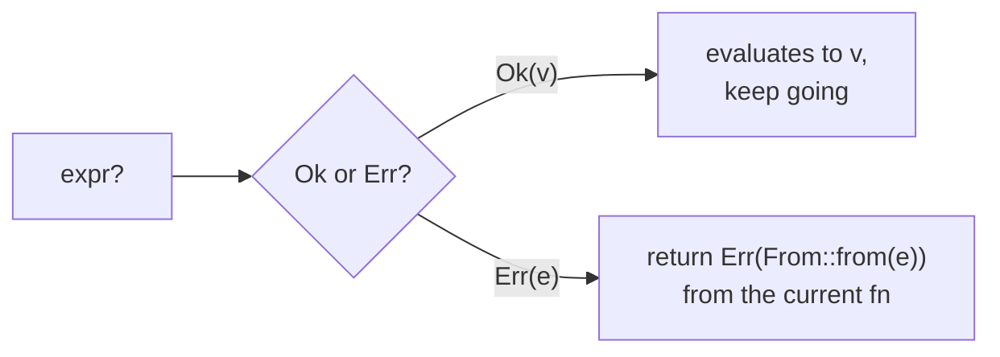
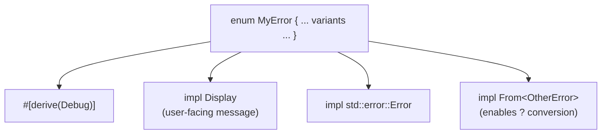

# Module 04 — Error Handling

> **Goal:** handle failure the Rust way — errors are **values** (like Go),
> but the compiler won't let you ignore them, and `?` removes the boilerplate.
>
> ⏱️ ~3 hours · 🧪 `cargo test -p m04-error-handling`

## 1. Two kinds of failure

| Kind | Rust tool | Use when | Analogy |
|---|---|---|---|
| **Unrecoverable** (bug) | `panic!`, `unwrap()`, `expect()`, index out of bounds | invariant broken, can't continue | Go `panic`, Java `Error` |
| **Recoverable** (expected) | `Result<T, E>` | file missing, bad input, network down | Go `(T, error)`, Java checked exception |

```rust
enum Result<T, E> { Ok(T), Err(E) }
```

> 💡 **Why two separate mechanisms?** Exceptions mix *bugs* (null deref, bad
> index) and *expected failures* (file not found) into one mechanism, so
> callers can't tell which ones they're meant to handle. Rust splits them, as
> Go does: `panic!` for "the program is wrong", `Result` for "the world is
> messy". And `Result` is **just an enum** (Module 03), not special syntax, so
> `match`, `if let` and methods all work on errors too.

## 2. Go programmers: you'll feel at home

```go
// Go
n, err := strconv.Atoi(s)
if err != nil {
    return 0, err
}
```

```rust
// Rust — `?` does exactly the same thing
let n: i32 = s.parse()?;
```



Key differences from Go:

* You **can't** accidentally ignore an error — a `Result` must be used (`#[must_use]`), and you can't get the `T` out without handling `Err`.
* `?` also **converts** the error type via `From` — that's how different error types compose.
* `?` works on `Option` too (in functions returning `Option`).

> 💡 **Why an operator?** Go's approach is explicit but noisy (three lines per
> fallible call). Exceptions are concise but invisible (any line might jump
> out). `?` is both concise **and** visible: one character, at every place an
> error can leave the function, and still just a plain `return`. (Early Rust
> used a `try!(...)` macro; `?` replaced it in 2016 because it chains nicely:
> `File::open(p)?.read_to_string(&mut s)?`.)

## 3. Java/Python programmers: what changes

| Exceptions (Java/Python) | `Result` (Rust) |
|---|---|
| invisible in signatures (unchecked / Python) | **always in the signature** |
| control flow jumps up the stack | ordinary return value |
| `try/catch` | `match`, `if let`, `?`, combinators |
| costly stack unwinding | zero-cost |

> 💡 **Why no exceptions at all?** Hidden control flow: with exceptions, any
> call might abort your function halfway and leave state half-updated, and
> nothing in the code warns you. With `Result`, every exit point is either a
> `return` or a `?` you can see. Java's *checked* exceptions tried to put
> errors in signatures, but they don't compose well with lambdas and generics.
> `Result` is an ordinary type, so it works naturally with both.

## 4. Building a good error type

The idiomatic recipe for a library error:



> 💡 **Why so many small pieces?** Each trait does exactly one job: `Debug`
> for developers, `Display` for end users, `Error` so it plugs into generic
> error handling (`Box<dyn Error>`, cause chains), and `From` so `?` can
> convert it. Java gives you one `Exception` base class that does everything;
> Rust lets you opt into just the abilities you need. **`#[derive(...)]`**
> asks the compiler to write the boring impl for you.

In real projects you'll use crates that generate this boilerplate:

* **`thiserror`** — for libraries (derive Display/From on your enum)
* **`anyhow`** — for applications (one "any error" type with context: `.context("reading config")?`)

You'll write it by hand here first, so you know what those macros do.

## 5. Option/Result combinators cheat sheet

| Method | On | Does | Similar to |
|---|---|---|---|
| `map(f)` | both | transform the success value | Java `Optional.map` |
| `and_then(f)` | both | chain a fallible step | `flatMap` |
| `ok_or(e)` | Option | `None` → `Err(e)` | |
| `ok()` | Result | `Err` → `None` | |
| `map_err(f)` | Result | transform the error | wrapping an error in Go |
| `unwrap_or(x)` | both | fallback value | `getOrDefault`, Python `or` |
| `filter(p)` | Option | `Some` only if predicate holds | `Optional.filter` |

> 💡 **Why both `match` and combinators?** Use combinators for short, linear
> transforms in a chain (like Java's `Optional` / streams), and `match` when
> the logic really branches. Both compile to the same machine code, so pick
> whichever reads better.

## 6. When is `unwrap()` OK?

* ✅ tests, examples, prototypes
* ✅ when you can *prove* it can't fail — prefer `expect("why this can't fail")`
* ❌ on user input, files, network — anything the outside world controls

> 💡 **Why is it called `expect`?** It reads as "I *expect* this to be `Ok`,
> because…". The message documents the assumption you're relying on, like an
> `assert` comment, and it shows up in the panic output when the assumption
> turns out wrong. A bare `unwrap()` leaves the next reader guessing.

## 🧪 Exercises (`src/lib.rs`)

| # | Item | Concept |
|---|---|---|
| 1 | `parse_age` | `Result<T, String>`, `map_err` |
| 2 | `divide` | error enum, `ok_or` |
| 3 | `sum_strings` | `?` in a loop / collecting `Result`s |
| 4 | `ConfigError` + `parse_config_line` | Display, Error, `From` + `?` |
| 5 | `first_even_doubled`, `display_name` | combinators instead of `match` |
| 6 | `total_of_config` | `Box<dyn Error>` |
| 7 | `Wallet` | errors with data, atomic operations |

## 🤔 Check your understanding

1. In `parse_config_line`, what exactly does `value.trim().parse()?` expand to? Write it out as a `match`.
2. Why does `Wallet::transfer` need to check `other.frozen` *before* calling `self.withdraw`?
3. When would you choose an error enum over `Box<dyn Error>`? *(Think: who consumes the error — a program, or a human?)*

➡️ Next: [Module 05 — Collections, Iterators & Closures](../05-collections-iterators/README.md)
· 🛠️ Or first: [Project P1 — wordstat](../../projects/p1-wordstat/README.md) (milestones 1–3)
