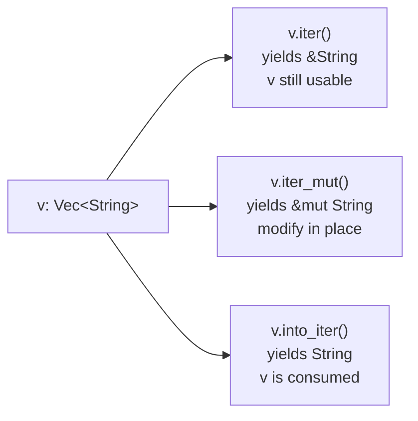
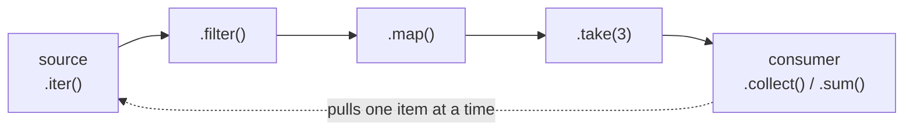

# Module 05 — Collections, Iterators & Closures

> **Goal:** write data-processing code that is as expressive as Python,
> as explicit as Go, and compiles down to the same machine code as a
> hand-written loop ("zero-cost abstractions").
>
> ⏱️ ~4 hours · 🧪 `cargo test -p m05-collections-iterators`

## 1. The core collections

| Rust | Go | Java | Python | Notes |
|---|---|---|---|---|
| `Vec<T>` | `[]T` | `ArrayList<T>` | `list` | growable, contiguous |
| `[T; N]` | `[N]T` | `T[]` | — | fixed size, on the stack |
| `&[T]` | slice header | — | — | borrowed view |
| `HashMap<K, V>` | `map[K]V` | `HashMap` | `dict` | unordered |
| `BTreeMap<K, V>` | — | `TreeMap` | — | sorted by key |
| `HashSet<T>` / `BTreeSet<T>` | `map[T]struct{}` | `HashSet` / `TreeSet` | `set` | |
| `VecDeque<T>` | — | `ArrayDeque` | `collections.deque` | ring buffer |

> 💡 **Why both `HashMap` and `BTreeMap`?** Rust makes the cost model a
> visible choice: hashing is O(1) but unordered, while a B-tree is O(log n)
> but sorted (good for ranges and deterministic output). Go's and Python's
> standard libraries ship only a hash map. **Why `[T; N]` with the length in
> the type?** The size is known at compile time, so it can live on the stack
> with no allocation (`[i32; 3]` and `[i32; 4]` are different types, as in Go).
> **`<T>`** angle brackets are generics, the same idea as Java's `List<T>`.

### The entry API (no double lookups)

```rust
// Python: counts[w] = counts.get(w, 0) + 1
// Go:     counts[w]++
*counts.entry(w).or_insert(0) += 1;           // Rust
groups.entry(key).or_default().push(item);    // like Python's defaultdict(list)
```

> 💡 **Why the entry API?** "Look it up; if it's missing, insert; then update"
> costs two hash lookups in most languages, and in Rust it would also fight
> the borrow checker (a lookup result is a borrow of the map). `entry` does
> **one** lookup and hands you the slot, filled or empty. `or_insert` returns
> `&mut V`, a reference *into* the map, so the leading `*` updates the stored
> value in place.

## 2. Three ways to iterate — ownership again!



`for x in &v` = `v.iter()`, `for x in &mut v` = `v.iter_mut()`, `for x in v` = `v.into_iter()`.

> 💡 **Why three versions?** Ownership again: you either *borrow to read*,
> *borrow to modify*, or *take the elements* (moving them out, with no
> clones). Java and Python iteration always hands out shared references, so
> there's no way to say "I'm done with this list, give me its contents". The
> `&` / `&mut` / nothing pattern is the same one used for function arguments
> in Module 02.

## 3. Iterators are lazy



Nothing happens until a **consumer** pulls. Like Python generators or Java Streams — but monomorphized and inlined, so no allocations or virtual calls in between.

| Adapters (lazy) | Consumers (run it) |
|---|---|
| `map filter filter_map` | `collect sum product count` |
| `enumerate zip chain` | `fold reduce` |
| `take skip take_while skip_while` | `min max min_by_key max_by_key` |
| `flat_map flatten` | `find position any all` |
| `rev peekable scan` | `for_each last nth` |

> 💡 **Why lazy?** Chaining `filter` → `map` → `take` never builds an
> in-between list (unlike chaining Python list comprehensions or JavaScript's
> `.map().filter()`). It can also stop early (`take`, `find`, `any`) and even
> work on infinite sequences (`(1..).map(...)`). The compiler then fuses the
> whole chain into a single loop, often as fast as an indexed `for`.

`collect()` is generic over the target: `Vec`, `HashMap`, `String`, `HashSet`, even `Result<Vec<_>, E>`. Tell it via the variable type or turbofish `collect::<Vec<_>>()`.

> 💡 **Why the odd `::<>` "turbofish"?** Writing `collect<Vec<_>>()` would be
> ambiguous to the parser: is `<` a generic or a less-than comparison? The
> extra `::` settles it. Java has the same problem and solves it differently
> (`Collections.<String>emptyList()`). Most of the time you skip it and
> annotate the variable instead.

## 4. Closures and the three `Fn` traits

```rust
let factor = 3;
let triple = |x: i32| x * factor;   // captures `factor` by reference
```

| Trait | Closure may… | Can call | Example |
|---|---|---|---|
| `Fn` | read captured vars | many times | `\|x\| x + n` |
| `FnMut` | mutate captured vars | many times | `\|\| { count += 1; count }` |
| `FnOnce` | move captured vars out | once | `\|\| drop(s)` |

Every `Fn` is also `FnMut`, and every `FnMut` is also `FnOnce`. Ask for the *weakest* bound you need (`FnOnce` > `FnMut` > `Fn` in flexibility for callers).

`move` forces the closure to **own** what it captures — required when the closure outlives the current function (returning it, sending it to a thread).

| | Go | Java | Python | Rust |
|---|---|---|---|---|
| Closure captures | by reference, always | effectively-final copies | by reference (late binding!) | by ref, by mut ref, or by move — **inferred**, or forced with `move` |

> 💡 **Why three `Fn` traits?** The garbage collector is what lets Go and
> Python closures capture anything by reference. Without one, Rust has to know
> whether calling a closure *reads*, *mutates*, or *consumes* what it captured,
> and the three traits encode exactly that. APIs use them to state their
> promise: `sort_by` calls your closure many times (`FnMut`), `thread::spawn`
> calls it once (`FnOnce`). The same rules also block Python's late-binding
> trap: `[lambda: i for i in range(3)]` gives three functions that all return
> `2`.

> 💡 **Why `|x|` instead of `x ->` / `lambda x:`?** Pipes are short and can't be
> confused with anything else inside an expression (the syntax comes from
> Ruby/Smalltalk blocks). The body is just an expression, so `|x| x * 2` needs
> no `return` and no braces.

## 5. Implementing `Iterator` yourself

```rust
impl Iterator for Countdown {
    type Item = u32;                          // "associated type"
    fn next(&mut self) -> Option<u32> { ... } // the ONLY required method
}
```

Implement `next` and you get `map`, `filter`, `sum`, `zip`, … for free — your first taste of **traits** (Module 06).

> 💡 **Why `type Item` instead of `Iterator<u32>`?** Each iterator yields
> exactly *one* kind of item, so it's a property of the impl, not a parameter
> chosen by the caller. That lets you write `I: Iterator` rather than
> `I: Iterator<T>` everywhere, and the compiler infers the item type. **Why
> one required method?** It's the same idea as Java's interface *default
> methods*: implement the minimum and inherit dozens of ready-made adapters.

## 🧪 Exercises (`src/lib.rs`)

| # | Items | Concept |
|---|---|---|
| 1 | `evens_squared`, `running_sum`, `dot` | adapter chains, `scan`, `zip` |
| 2 | `word_frequencies`, `top_n_words`, `group_by_length` | `HashMap`, entry API, sorting |
| 3 | `unique_sorted`, `is_anagram` | sets, sorting chars |
| 4 | `transpose`, `positive_flat` | nested collections, `flatten` |
| 5 | `apply_n`, `make_counter`, `make_adder`, `sort_people` | closures, `move`, `impl Fn` |
| 6 | `Countdown`, `Fib` | implementing `Iterator` |

## ⚠️ Pitfalls

* `.iter()` on `Vec<i32>` yields `&i32` — that's why you see `|&x|` or `.copied()`.
* `.filter()` gets a *reference to the item* — on `.iter()` that's `&&i32`. Hence `|&&n|` patterns.
  *Why:* `filter` only *looks at* each item before passing it on, so it
  borrows the item rather than taking it. Closure parameters are patterns,
  so `&&n` peels both references off in one go.
* `collect()` can't infer its type? Annotate: `let v: Vec<_> = ...`.

## 🤔 Check your understanding

1. Why does `make_counter` need `move`? What error do you get without it?
2. `apply_n(&add5, 2, 0)` passes a *reference* to a closure. Why does that work where `impl Fn` is expected?
3. Iterators are lazy: what does `v.iter().map(|x| println!("{x}"));` print, and what does the compiler warn?

➡️ Now finish [P1 milestone 4](../../projects/p1-wordstat/README.md), then unlock Module 06.
