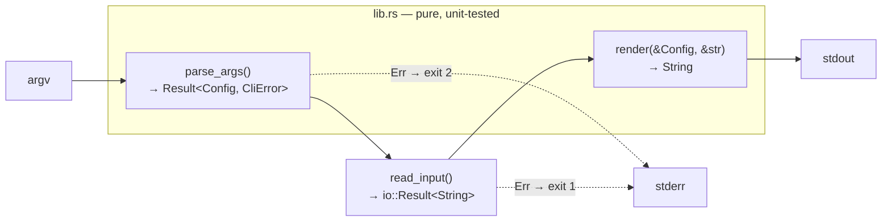

# 🛠️ Project P1 — `wordstat`: a `wc`-style CLI

> **When:** after Module 04 (milestones 1–3) · Milestone 4 after Module 05
> **You'll practice:** enums, structs, `Result`/`?`, custom errors, file &
> stdin I/O, exit codes, unit **and** integration tests.

```console
$ cargo run -p wordstat -- -w --top 3 projects/p1-wordstat/sample.txt
words: 24
top 3 words:
  is: 3
  rust: 2
  them: 2
```

## Architecture: functional core, imperative shell



All logic sits in `lib.rs` as pure functions that are trivially testable.
`main.rs` only does I/O and exit codes. This is the same pattern you'd use
in Go (`cmd/` + `internal/`) — Rust just makes it the default shape.

## Milestones

| # | Implement | Run | Concepts |
|---|---|---|---|
| 1 | `Field::label`, `Stats::count`, `Stats::get` | `cargo test -p wordstat m1_` | match, `&'static str`, chars vs bytes |
| 2 | `CliError` Display, `parse_args` | `cargo test -p wordstat m2_` | iterators by hand, enums, `?`, `ok_or` |
| 3 | `read_input`, `render`, `main` | `cargo test -p wordstat m3_` | I/O, `ExitCode`, `eprintln!`, integration tests |
| 4 | `top_words` (+ `--top` output) | `cargo test -p wordstat m4_` | `HashMap`, sorting with `then_with` |

✅ **Done when:** `cargo test -p wordstat` is all green **and**
`cargo clippy -p wordstat` reports nothing.

## Spec

| Flag | Meaning |
|---|---|
| `-l` `-w` `-c` `-b` | print lines / words / chars / bytes (any combination; default = all) |
| `--top N` | also print the N most frequent words |
| `FILE` | read from a file |
| `-` or nothing | read from stdin |

* Output fields always appear in the order lines → words → chars → bytes.
* Usage errors → message + usage on **stderr**, exit code **2**.
* I/O errors → message on **stderr**, exit code **1**.

## 🌶️ Stretch goals (pick any, then ask for review)

1. **Better I/O errors:** include the file name — `wordstat: notes.txt: No such file or directory`.
2. **Multiple files**, with a `total` line, like real `wc`. (You'll need to redesign `Input` and `Config` — that's the point!)
3. **Streaming:** handle a 2 GB file without loading it all into memory, using `BufReader::lines()`. What happens to `top_words`?
4. **Real CLI parsing:** replace `parse_args` with the `clap` crate (derive API). Compare the amount of code.
5. **`--json` output** using `serde` + `serde_json`.

## 🤔 Reflection questions for your review

1. Why is `render` easier to test than a function that prints directly?
2. `read_input` returns `io::Result<String>`, but `parse_args` returns `Result<Config, CliError>`. Why not one error type for both? Should there be one?
3. What does `env!("CARGO_BIN_EXE_wordstat")` do in `tests/cli.rs`, and why is it better than hard-coding `target/debug/wordstat`?
